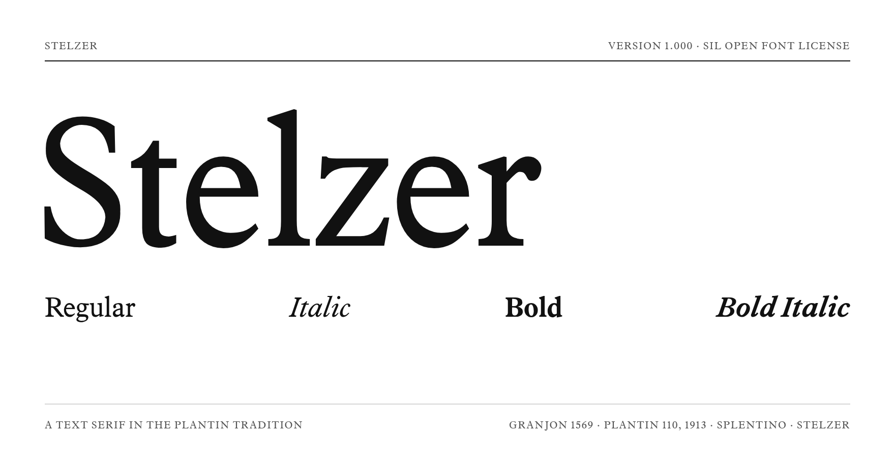

# Stelzer

*Four-style text serif in the Plantin tradition, via Splentinex. Early release, v1.000.*



Full specimen: [Stelzer-Specimen.pdf](Stelzer-Specimen.pdf)

## What it is

Stelzer is a face for ordinary prose with a large x-height and compact proportions. It is an
experimental modification of Splentinex that tightens the fit, lengthens the ascenders and
descenders, steadies the contrast and makes other small refinements.

## Lineage

> Gros Cicero (Granjon, 1569) → Monotype Plantin 110 (Pierpont and Fritz Stelzer, 1913) →
> Splentino (Ben Byram-Wigfield for Steinberg, 2025) → Splentinex (Daniel Benjamin Miller,
> 2025) → Stelzer (2026)

The name honours Fritz Stelzer, Frank Hinman Pierpont's assistant at Monotype, who cut
Plantin 110 under his direction in 1913.

## What changed from Splentinex

Built by measured, mathematical transformations of Splentinex's outlines rather than by
redrawing glyphs by hand.

- Larger x-height: 460 → 479 units (485 in Bold, 492 in Bold Italic), with taller ascenders,
  deeper descenders and a tighter fit; word space 260 → 192.
- Tuned contrast: lighter capital stems, heavier hairlines and crossbars, tighter spacing on
  straight-sided letters.
- Steeper italic: 16° → 19°.
- Family fixes: one set of vertical metrics across all four styles with a 1.2 em default line
  height, mark positioning in every style, a visible .notdef, a STAT table, stray control
  characters and an empty Greek mu unmapped, kerning checked for collisions, and hinting for
  both TTF and CFF.

## What you get

|              |                                                                     |
|--------------|---------------------------------------------------------------------|
| Styles       | Regular · Italic · Bold · Bold Italic                               |
| Formats      | otf/ (CFF) · ttf/ (hinted) · woff2/ (web)                           |
| Coverage     | Latin: Western European, and most Central European (see Known gaps) |
| Units per em | 1000                                                                |
| Version      | 1.000                                                               |

## Features by style

| Feature                                            | Regular | Italic | Bold | Bold Italic |
|----------------------------------------------------|---------|--------|------|-------------|
| Kerning                                            | ✓       | ✓      | ✓    | ✓           |
| Ligatures — ff fi fl ffi ffl                       | ✓       | ✓      | ✓    | ✓           |
| Lining, oldstyle, proportional and tabular figures | ✓       | ✓      | ✓    | ✓           |
| Fractions                                          | ✓       | —      | ✓    | —           |
| Ordinals                                           | ✓       | ✓      | ✓    | —           |
| Small caps                                         | ✓       | —      | —    | —           |
| Superior figures, digits 1–3                       | ✓       | —      | —    | —           |
| Swashes — J Q                                      | —       | —      | —    | ✓           |

## Known gaps

- Small caps and superior figures are Regular-only; fractions are Regular and Bold only.
- Missing in every style: ẞ, IJ, Ģ ģ (Latvian), Ŋ ŋ, Ŀ ŀ, ĸ, ʼn, ſ and the micro sign µ.
  Bold also lacks Ľ ľ and Ħ ħ.
- Italic, Bold and Bold Italic have a smaller symbol set than Regular (no ¹ ² ³ ¤ ¬, among
  others).
- Combining accents are encoded in the Regular only. Precomposed accented letters are in all
  four styles, and most apps compose decomposed input automatically.
- Greek and Cyrillic are not supported.

## Using it

### Desktop

Download the zip from the latest Release, tagged v1.000, and install the OTFs, or the TTFs
on Windows.

### Web

```css
@font-face {
  font-family: "Stelzer";
  src: url("woff2/Stelzer-Regular.woff2") format("woff2");
  font-weight: 400;
  font-style: normal;
  font-display: swap;
}
/* then Italic (400 italic), Bold (700), Bold Italic (700 italic) */
```

## Licence and credits

- Licence — SIL Open Font License 1.1, in [OFL.txt](OFL.txt). The licence text is also
  embedded in the fonts.
- Copyright — © 2025 Steinberg Media Technologies GmbH; © 2025 Daniel Benjamin Miller;
  © 2026 The Stelzer Project Authors.
- Credited in the fonts — Ben Byram-Wigfield, Daniel Benjamin Miller, The Stelzer Project
  Authors.
- Reserved names — "Splentino" is a Reserved Font Name and is not used here. "Stelzer" is
  not reserved, so forks may keep the name or rename it as they prefer.

> Not affiliated with, endorsed by or connected to Monotype, Steinberg or any designer named
> above. Plantin is a trademark of Monotype; no trademark rights are claimed in any of those
> names.

## Repository layout

```
otf/                  four styles, CFF outlines
ttf/                  four styles, hinted
woff2/                four styles, for the web
specimen.png          the image above
Stelzer-Specimen.pdf  full type specimen
OFL.txt               the licence
```
